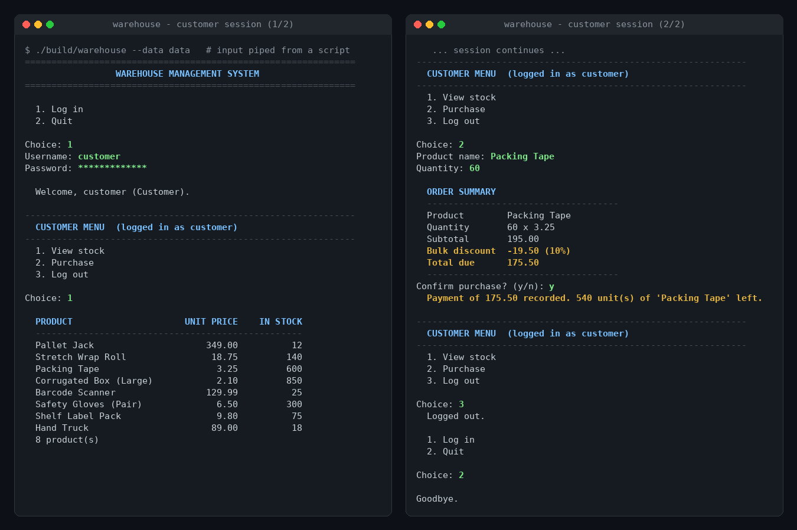
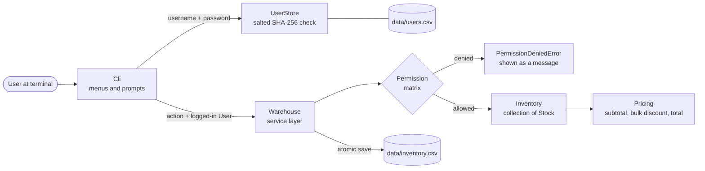
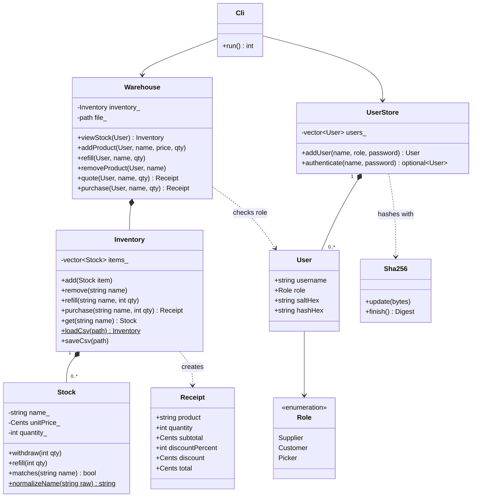
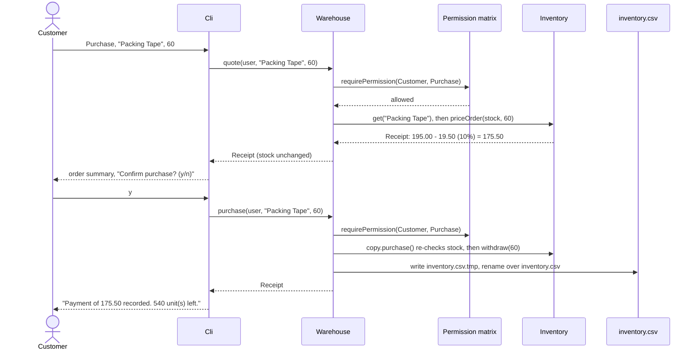

# 📦 Warehouse Management System

**A role-based inventory system in modern C++17: suppliers stock the shelves, customers place orders with automatic bulk discounts, and pickers restock, each through a password-protected terminal menu that only shows what that role is allowed to do.**


[](https://github.com/aish-19shanbhag/warehouse-management-system/actions/workflows/ci.yml)


| | |
|---|---|
| **Problem** | Model a warehouse where three kinds of users share one stock list but must only touch the parts of it their job allows |
| **Approach** | An object-oriented `Stock` / `Inventory` core, one permission matrix enforced in a service layer, salted SHA-256 logins, and human-readable CSV storage |
| **Result** | **78 automated tests, all passing** (261 assertions), zero compiler warnings, clean under AddressSanitizer and UndefinedBehaviorSanitizer |
| **Role** | Member of a 4-person Software Engineering course team; owned the core inventory logic and system testing. Built Jan 2021 to May 2021; refactored from Turbo-C style into portable C++17 in 2026 |

---

## Highlights

- **Object-oriented core.** A `Stock` class owns each product's name, price and quantity and guards every change (withdraw, refill); an `Inventory` class adds and removes product lines and saves them to disk.
- **Role-based access control for three user types**, Supplier, Customer and Picker, defined in **one permission matrix** and checked before every operation, so a hidden menu item can never be reached another way.
- **No plaintext passwords.** Accounts are stored as a random per-user salt plus a SHA-256 hash. The SHA-256 implementation is written from scratch and verified against the official FIPS 180-4 test vectors.
- **Order totals with a bulk discount** (5% from 20 units, 10% from 50), computed in integer cents so totals are always exact.
- **78 automated tests** in a self-written test framework with no external dependencies, run on every push by GitHub Actions.
- **Every defect identified in the 2021 code is fixed**, including a real buffer overflow in the login routine (see [What the 2026 refactor fixed](#what-the-2026-refactor-fixed)).

## ✨ Key features

| | Feature | What it does |
|---|---|---|
| 🧱 | **`Stock` and `Inventory` classes** | Encapsulate the core operations: add, withdraw, refill and remove, each validated so stock can never go negative |
| 🔐 | **Password-gated logins** | Username and password checked against salted SHA-256 hashes; typing is hidden on a real terminal; 3 attempts per login |
| 🛂 | **Permission matrix** | One table decides what each role may do; menus are generated from it and the service layer enforces it |
| 🧾 | **Payment and bulk discount** | An order summary shows subtotal, discount and total before the customer confirms |
| 💾 | **CSV persistence** | Stock and accounts live in plain CSV files you can open in Excel or diff in Git; saves are atomic (write a temp file, then rename) |
| 🛡️ | **Input validation** | Rejects negative or malformed prices, non-numeric or negative quantities, unknown products and duplicate names with clear messages |
| 🖥️ | **Portable CLI** | Standard C++ only; builds on Linux, macOS and Windows; no `conio.h`, no `system("cls")`, no `goto` |
| ✅ | **Tested and CI-checked** | 78 unit and end-to-end tests run by CTest and GitHub Actions on every push |

## Demo

<p align="center"></p>

A real, unedited session with scripted input: a customer views stock, orders 60 rolls of packing tape, receives the 10% bulk discount and confirms. The full text, plus a picker restocking session, is in [`docs/cli_session.txt`](docs/cli_session.txt). When input is piped, the CLI echoes each answer (passwords as asterisks) so recorded sessions read like a live terminal.

### Demo accounts

The shipped [`data/users.csv`](data/users.csv) contains three demo accounts (hashes only; these passwords appear nowhere else in the repository):

| Username | Password | Role |
|---|---|---|
| `supplier` | `Supplier@2026` | Supplier |
| `customer` | `Customer@2026` | Customer |
| `picker` | `Picker@2026` | Picker |

Create more with `./build/warehouse --data data --add-user NAME ROLE` (you are prompted for the password twice).

---

## Roles and permissions

| Action | Supplier | Customer | Picker |
|---|:---:|:---:|:---:|
| View stock | ✅ | ✅ | ✅ |
| Add new product | ✅ | | |
| Refill stock | ✅ | | ✅ |
| Remove product | ✅ | | |
| Purchase | | ✅ | |

These are the same responsibilities each role had in the 2021 program. The difference is where they live: in 2021, a role's rights were implied by which menu its password unlocked; now they are a single table in [`src/permissions.cpp`](src/permissions.cpp), and `Warehouse` calls `requirePermission(role, action)` at the start of every operation. Permission is checked **before** input is validated, so a customer probing for product names gets "permission denied", not "not found".

## Payment and discount rule

When a customer orders, the system prices the order first and shows a summary; stock changes only after the customer confirms.

| Quantity in one order | Discount on the line subtotal |
|---|---|
| 1 to 19 | none |
| 20 to 49 | 5% |
| 50 or more | 10% |

- Prices are stored as integer cents, so `7 x 18.75` is exactly `131.25` (the 2021 version used `float`).
- The discount is rounded half-up to the nearest cent.
- **The bulk discount was added in the 2026 refactor.** The 2021 program printed `price x quantity` as the amount to pay. The tiers live in one constant (`kBulkDiscountTiers` in [`include/wms/pricing.hpp`](include/wms/pricing.hpp)).
- "Payment" is recorded, not processed: there is no card or payment gateway.

---

## Architecture



Every change follows the same pattern inside `Warehouse`: check permission, apply the change to a **copy** of the inventory, save the copy, then make it current. If the save fails, nothing in memory changes.

## Class design



## A customer purchase, step by step



---

## Testing

### Original 2021 course testing (as reported)

As part of the Software Engineering course, the team wrote and executed **29 test cases across all user modules (Supplier, Customer, Picker). 24 of 29 passed, an 82.8% pass rate**, and the failures surfaced defects in the **payment and discount workflows**. These figures are reported from the 2021 project; the original test documents are not in this repository, and the single 2021 source file that survives ([`legacy/warehouse_management_2021.cpp`](legacy/warehouse_management_2021.cpp)) contains no discount logic, so those results cannot be re-run from it. Reading that file does show payment problems of the kind described: a negative purchase quantity produced a negative amount due and *increased* stock, because quantities were never validated.

### Automated test suite (2026)

The refactor adds an automated suite built on [`tests/mini_test.hpp`](tests/mini_test.hpp), a small test framework written for this project (about 160 lines, no downloads). The latest run, with its full output in [`docs/test_output.txt`](docs/test_output.txt):

```
78 tests, 78 passed, 0 failed, 261 assertions
```

| Area | Tests | What is covered |
|---|---:|---|
| Stock and money | 14 | Construction rules, withdraw and refill limits, case-insensitive matching, price parsing and formatting |
| Inventory | 7 | Add, duplicate rejection, lookup, remove, refill, purchase, failed purchase leaves stock untouched |
| Persistence | 8 | Exact CSV format, stream and disk round trips, atomic save, CRLF files, missing files, shipped sample data, users.csv round trip, every committed change reaching disk |
| Input validation | 8 | Bad names, prices, quantities, unknown products, corrupt CSV rows (with line numbers), bad usernames and short passwords, the 2021 overflow input |
| Payment and discount | 8 | Tier boundaries (19, 20, 49, 50), exact totals, half-up rounding, overflow safety, pricing never changes stock |
| Permissions | 6 | The full matrix for all three roles, menu order, role parsing |
| Permission enforcement | 5 | Each role through the `Warehouse` service, denied actions leave inventory unchanged, permission checked before validation |
| Authentication | 9 | Salted hashing, unique salts, correct and wrong passwords, case rules, no plaintext stored, old 2021 passwords rejected, shipped demo accounts |
| SHA-256 | 6 | FIPS 180-4 vectors (empty, "abc", 448-bit, 896-bit, one million "a"), padding boundaries at 55, 56 and 64 bytes |
| CLI end to end | 7 | Scripted sessions: discounted purchase, cancelled order, per-role menus, lockout after 3 failed logins, supplier workflow, error recovery, clean exit at end of input |
| **Total** | **78** | |

The suite also passes when compiled with `-fsanitize=address,undefined` (GCC 13) and with Clang 18, and the code builds with zero warnings under `-Wall -Wextra -Wpedantic -Wshadow -Wconversion`.

---

## What the 2026 refactor fixed

The original program is kept unchanged in [`legacy/`](legacy/warehouse_management_2021.cpp) for transparency. Line numbers below refer to that file.

| 2021 problem | Where | Fix in 2026 |
|---|---|---|
| **Buffer overflow at login.** 12 keystrokes were written into `char pass[10]`, with no terminating `'\0'`, then passed to `strcmp` | lines 275, 297-307 | Input is read into `std::string`; nothing has a fixed size |
| **Plaintext passwords compiled into the binary** (`"Suppliaccess"`, `"Customaccess"`, `"Pickeraccess"`), one shared password per role | lines 307, 379, 437 | Per-user accounts in `data/users.csv`, stored as random salt + SHA-256; constant-time comparison |
| **Windows-only I/O**: `conio.h`, `getch()` and `system("cls")` | line 3 and throughout | Standard streams only; hidden password typing via `termios` (Linux/macOS) or `SetConsoleMode` (Windows) |
| **`goto`-based menus** and a single 200-line `main` | lines 312-475 | One function per menu and action, each a plain loop |
| **Binary struct dumps** (`fout.write((char*)&st, sizeof(st))`) to `shop.dat`, tied to one compiler's memory layout | lines 109-119, 159-170 | Human-readable CSV with a header row, line-numbered parse errors and atomic saves |
| **No input validation**: negative quantities and prices accepted, unchecked `cin >> name` into `char[20]` | lines 43, 58, 158 | Every value validated, with a clear error message and no partial updates |
| **Global mutable state** (`st`, `fin`, `fout`, `fio`, `i`, `n`) | lines 7-10, 24 | State lives in objects; the CLI takes its streams as parameters, which is what makes it testable |
| **Float prices** printed as `pr * qty` | lines 15, 31 | Integer cents with exact formatting |
| **No automated tests** | | 78-test suite, CTest and GitHub Actions |

---

## 🧰 Tech stack

| Layer | Tools |
|---|---|
| Language | C++17 (standard library only: `<filesystem>`, `<optional>`, `<charconv>`, `<random>`) |
| Build | CMake 3.16+, or a single `g++` command |
| Security | Salted SHA-256 (own FIPS 180-4 implementation), constant-time comparison |
| Storage | CSV files with atomic write-and-rename |
| Testing | Self-written `mini_test.hpp` framework, CTest, AddressSanitizer / UBSan |
| CI | GitHub Actions (`ubuntu-latest`): configure, build, run tests, smoke-test the CLI |
| Compilers checked | GCC 13, Clang 18 (code also targets MSVC with `/W4`) |

## 🧠 Concepts demonstrated

- **Object-oriented design and encapsulation:** `Stock` keeps its fields private and only changes them through validated operations, so it can never hold an invalid state
- **Separation of concerns:** domain model (`Stock`, `Inventory`), business rules (`pricing`, `permissions`), service layer (`Warehouse`) and UI (`Cli`) are independent
- **Role-based access control:** one permission matrix, enforced in one place, with menus generated from it
- **Cryptographic hashing:** a from-scratch SHA-256, per-user salts, and constant-time comparison
- **File persistence:** a documented CSV format, parse errors with line numbers, and atomic saves
- **Error handling:** a small exception hierarchy and the strong exception guarantee (copy, change, save, then commit)
- **Unit and end-to-end testing:** a custom test framework, and dependency injection of streams so whole CLI sessions are testable
- **Continuous integration:** every push builds and tests on GitHub Actions
- **Refactoring legacy code:** finding and fixing memory-safety, security and portability defects

## Repository structure

```
warehouse-management-system/
├── include/wms/
│   ├── stock.hpp             # Stock: one product line (withdraw, refill, validation)
│   ├── inventory.hpp         # Inventory: add, remove, refill, purchase, CSV load/save
│   ├── pricing.hpp           # order totals and the bulk discount tiers
│   ├── permissions.hpp       # Role, Action and the permission matrix API
│   ├── auth.hpp              # User, UserStore, salted password hashing
│   ├── sha256.hpp            # self-contained SHA-256
│   ├── warehouse.hpp         # service layer: permission check, change, atomic save
│   ├── cli.hpp               # menu-driven terminal interface
│   ├── money.hpp             # integer-cent prices: parse and format
│   ├── text.hpp              # trim, split, safe integer parsing
│   └── errors.hpp            # exception hierarchy
├── src/                      # one .cpp per header, plus main.cpp (CLI entry point)
├── tests/
│   ├── mini_test.hpp         # the test framework (no external dependencies)
│   ├── test_stock.cpp        # Stock, money, name validation
│   ├── test_inventory.cpp    # Inventory and CSV persistence
│   ├── test_pricing.cpp      # payment totals and discounts
│   ├── test_permissions.cpp  # permission matrix and its enforcement
│   ├── test_auth.cpp         # hashing, login, users.csv
│   ├── test_sha256.cpp       # FIPS 180-4 test vectors
│   ├── test_cli.cpp          # scripted end-to-end CLI sessions
│   └── test_main.cpp
├── data/
│   ├── inventory.csv         # sample stock (8 products)
│   └── users.csv             # demo accounts: salts and hashes only
├── docs/
│   ├── cli_session.png       # screenshot used above
│   ├── cli_session.txt       # full text of the recorded sessions
│   └── test_output.txt       # output of the latest test run
├── legacy/
│   └── warehouse_management_2021.cpp   # original 2021 program, unchanged
├── .github/workflows/ci.yml  # build and test on every push
├── CMakeLists.txt
├── LICENSE
└── README.md
```

## Getting started

**Requirements:** a C++17 compiler with `<filesystem>` support (GCC 9+, Clang 9+ or Visual Studio 2019+) and, optionally, CMake 3.16+.

**With CMake (Linux, macOS, Windows):**

```bash
git clone https://github.com/aish-19shanbhag/warehouse-management-system.git
cd warehouse-management-system

cmake -S . -B build -DCMAKE_BUILD_TYPE=Release
cmake --build build
ctest --test-dir build --output-on-failure    # run the 78 tests

./build/warehouse --data data                 # start the app (log in with a demo account)
```

On Windows with Visual Studio, the binaries are under a configuration folder: run `ctest --test-dir build -C Debug` and `build\Debug\warehouse.exe --data data` (or pass `--config Release` to the build step and use `Release`).

**With a single g++ command (no CMake):**

```bash
g++ -std=c++17 -O2 -Iinclude src/*.cpp -o warehouse
./warehouse --data data

# tests
g++ -std=c++17 -Iinclude -DWMS_SOURCE_DIR='"."' $(ls src/*.cpp | grep -v main.cpp) tests/*.cpp -o wms_tests
./wms_tests
```

**Other commands:**

```bash
./build/warehouse --data data --add-user alice Customer   # create an account
./build/warehouse --help
```

The app reads and writes `inventory.csv` and `users.csv` in the folder given by `--data` (default `./data`). Changes are saved immediately, so copy the folder first if you want to keep the sample data pristine.

## Limitations and next steps

- **Password hashing:** salted SHA-256 is far better than plaintext, but a production system should use a deliberately slow algorithm such as Argon2, bcrypt or PBKDF2 to resist brute-force attacks.
- **Single user at a time:** the CSV files have no locking, so two copies of the program writing at once could overwrite each other. A database such as SQLite would add transactions and concurrent access.
- **Payment is simulated:** totals and discounts are calculated and recorded in stock, but there is no order history, invoice file or payment gateway.
- **Product names** cannot contain commas or double quotes, to keep the CSV format simple; a full CSV quoting parser would lift that.
- **Platform testing:** CI runs on Ubuntu, and the code was also compiled with Clang locally; the Windows console code path is written to the Win32 API but is not yet exercised in CI. Adding Windows and macOS runners to the workflow is the next step.
- **Next features:** an audit log of who changed what, low-stock alerts for pickers, an admin role to manage accounts from the menu, and a REST API in front of the same `Warehouse` service.

## Team and credits

This began as a **4-person team project** for a Software Engineering course (Jan 2021 to May 2021). The original program credits the team in its closing screen as "Developed by NavyaNayanaShloka". My contributions were the core inventory logic (the stock class and its add, withdraw, refill and remove operations) and system testing, including the 29-case test effort. The 2026 refactor, automated test suite, discount rule and documentation were added after the course ended.

## Author

**Aishwarya Ramanath Shanbhag**, MS Computer Science, San José State University
[GitHub](https://github.com/aish-19shanbhag) · [LinkedIn](https://www.linkedin.com/in/aishwarya-ramanath-shanbhag-452255185/) · [Portfolio](https://aish-19shanbhag.github.io/)

Released under the [MIT License](LICENSE).
